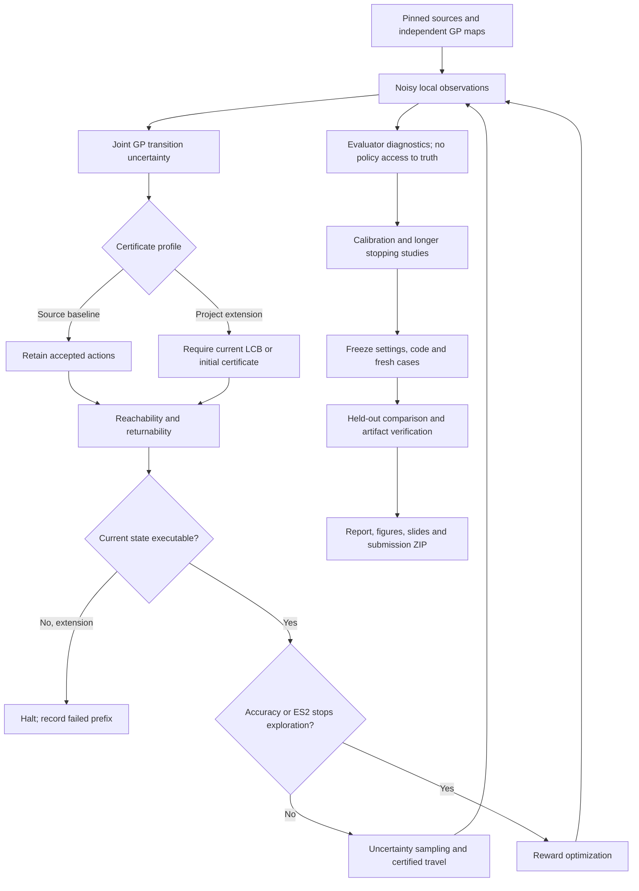

# SNO-MDP project delivery roadmap

**Paper:** Wachi and Sui, ICML 2020.  
**Question:** How do sensor-noise assumptions, confidence settings, and certificate retention affect exploration, safety, reward, and ES²?  
**Scope:** Source-audited headless GP-Safety-Gym benchmark; a clearly labeled current-LCB project extension.

## Experiment pipeline

## Implemented software

| Component | Evidence |
|---|---|
| Source/data provenance and original baseline | Pinned reference archive, licenses, source-equivalence tests |
| GP regression and transition covariance | Independent numerical checks; exact repeated-reading sufficient statistics |
| Safe exploration, basic SNO-MDP, ES², oracle | Action masks, paths, online updates, and stopping tests |
| Current-LCB alternative | Recomputed graph, recertification, and explicit region-loss failure |
| Confidence and certificate diagnostics | Coverage, acceptance history, pre-action bounds, and source/input hashes |
| Controlled research runner | All planned policies, setup/model failures, matched conditions, and map aggregation |
| Frozen final protocol and verifier | Code/config guards, complete inventory, action/return/certificate checks |
| Presentation and packaging tools | Report, PDF/browser slides, notes, manifest, complete ZIP |
| Interactive analysis workspace | `python3 -m analysis_ui`: replay, exact GP-bound inspection, matched comparisons, parameter sweeps, and graph/CSV exports; [guide](docs/interactive_ui.md) |

## Evidence sequence

1. **Calibration:** 42 planned cases; multipliers 2/3/4, both modes, three development maps, two observation seeds, horizon 120.
2. **Selection:** apply the rule written in `configs/selection_rule.json` before calibration: failure rate, unsafe-run rate, negative mean reference ratio, then multiplier.
3. **Stopping validation:** 30 planned cases; source and revalidated basic/ES² at horizons 120/240, plus oracle.
4. **Freeze:** save selected settings, exact source hashes, final horizon 160, fresh maps 100–105, observations 3000/3001, and all planned cases.
5. **Final evaluation:** noise factors 0.5/1/2; source methods, selected-confidence control when distinct, revalidation extension, and oracle. Include failures and unfavorable results.
6. **Verification:** audit each actual action, current-bound enforcement, return prefix, matched map, and protocol. Reproduce selected cases in fresh temporary directories.
7. **Delivery:** complete [report](report/report.md), scientific figures, slides, source/data attribution, reproduction commands, and submission archive.

Completion records are saved in each study’s `summary.json` and `verification.json`; an incremental `progress.json` is not evidence of a completed study. The final report distinguishes measured results from assumptions and original-paper guarantees.

## Team review before presenting

| Member | Proposed ownership | Cross-review |
|---|---|---|
| 1 | Environment, dynamics, source audit | Initial certificates and action safety |
| 2 | GP covariance and confidence calibration | Reward/ES² calculations |
| 3 | Exploration, ES² and revalidation | Environment-policy integration |
| 4 | Experiments, statistics and report | Fairness and reproducibility |

Actual names and contributions must be confirmed in `report/team_review.md`. Each member should explain one worked example and the complete pipeline. Another team member must reproduce a saved case in their environment; automated same-environment checks do not attest that human review.

Native legacy MuJoCo, P-ES², exact published figures, hardware deployment, and measured-Mars experiments are outside this defined submission scope. Practical confidence bands and finite evaluation do not establish a safety guarantee.
