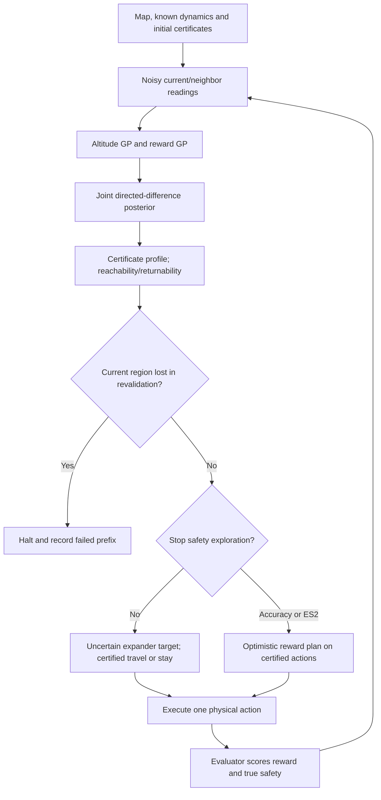

# Paper #34 and Our SNO-MDP Project: Complete Learning and Presentation Guide

**Paper:** Akifumi Wachi and Yanan Sui, *Safe Reinforcement Learning in Constrained Markov Decision Processes*, ICML 2020.  
**Project:** SNO-MDP reproduction, sensor-noise robustness, and certificate revalidation.  
**Review date:** 14 November 2026.  
**Basis:** The local 16-page arXiv v1 PDF, pinned reference source, current Python implementation, and saved experiment records.

This is the main study document for understanding the project from fundamentals through presentation. It explains the central mathematics and proof ideas; the linked paper remains the authority for exact theorem statements and full proofs.

Throughout this guide:

- **Paper** means the algorithm and assumptions described in the paper.
- **Source-profile baseline** means our documented port of choices in the released implementation.
- **Project extension** means our current-LCB certificate-revalidation alternative.
- **Measured result** means an outcome in our saved experiments, not a universal guarantee.

Keep these four categories separate when writing or presenting.

**Interactive companion:** Run `python3 -m analysis_ui` from this project folder and open http://127.0.0.1:8765 to inspect the saved evidence and launch exploratory experiments. The [dashboard walkthrough](docs/interactive_ui.md) connects the controls, maps, GP bounds, and comparison graphs to the concepts in this guide.

## Contents

1. [The problem and our objective](#1-the-problem-and-our-objective)
2. [Prerequisites and notation](#2-prerequisites-and-notation)
3. [MDPs, reward, and hard safety constraints](#3-mdps-reward-and-hard-safety-constraints)
4. [Gaussian processes from the beginning](#4-gaussian-processes-from-the-beginning)
5. [The paper: assumptions and safe regions](#5-the-paper-assumptions-and-safe-regions)
6. [The paper: safety exploration](#6-the-paper-safety-exploration)
7. [The paper: reward optimization](#7-the-paper-reward-optimization)
8. [The paper: ES² and P-ES²](#8-the-paper-es2-and-p-es2)
9. [The paper: guarantees and proof ideas](#9-the-paper-guarantees-and-proof-ideas)
10. [The paper: experiments and reading map](#10-the-paper-experiments-and-reading-map)
11. [What our project reproduces and changes](#11-what-our-project-reproduces-and-changes)
12. [Our grid, data generation, and sensors](#12-our-grid-data-generation-and-sensors)
13. [Our GP calculations and safety decisions](#13-our-gp-calculations-and-safety-decisions)
14. [Retained certificates and our extension](#14-retained-certificates-and-our-extension)
15. [One complete execution loop](#15-one-complete-execution-loop)
16. [Reward and return accounting](#16-reward-and-return-accounting)
17. [The code and configuration map](#17-the-code-and-configuration-map)
18. [Experiment design and frozen evaluation](#18-experiment-design-and-frozen-evaluation)
19. [Actual results and defensible conclusions](#19-actual-results-and-defensible-conclusions)
20. [How to read the HTML replay and graphs](#20-how-to-read-the-html-replay-and-graphs)
21. [Run and independently reproduce a case](#21-run-and-independently-reproduce-a-case)
22. [Diagnostics, artifacts, and tests](#22-diagnostics-artifacts-and-tests)
23. [Professor demonstration and slide narrative](#23-professor-demonstration-and-slide-narrative)
24. [Questions you should be able to answer](#24-questions-you-should-be-able-to-answer)
25. [Understanding checks with answers](#25-understanding-checks-with-answers)
26. [Submission, packaging, and remaining human work](#26-submission-packaging-and-remaining-human-work)
27. [References and further reading](#27-references-and-further-reading)

Read Sections 1–10 to understand the paper, 11–20 to understand the implemented study, and 21–26 to reproduce and present it. Return to the numerical examples when a symbol or graph becomes unclear.

## 1. The problem and our objective

Imagine a rover exploring an unfamiliar area. It wants useful measurements, represented by reward, while avoiding hazardous movements. It does not initially know either the reward field or all safety constraints.

Two incomplete solutions are easy:

- Staying in a known safe location may avoid danger but collect little useful reward.
- Chasing promising reward without establishing safety may cause violations.

SNO-MDP addresses this tension by first learning enough safety information, then optimizing reward within a certified region. ES² asks whether safety exploration can stop before the entire region has been resolved.

Our project asks:

> How do practical confidence settings, incorrect sensor-noise assumptions, and retention of old safety certificates affect exploration, reward, and unsafe actions?

We implemented the documented source-profile baseline, diagnosed its practical certificate failures, added a clearly labeled revalidation extension, and evaluated both under controlled conditions.

The current environment is a **headless discrete simulation** based on the authors’ GP-Safety-Gym benchmark model. Its maps are synthetic GP-generated fields in the final study. The original legacy MuJoCo renderer, physical rover deployment, and the paper’s Mars experiment are outside our implemented submission scope.

The completed controlled studies contain **42 calibration cases, 30 stopping-validation cases, and 192 held-out cases**. The final study uses six fresh maps. These are separate stages, not 264 independent maps.

## 2. Prerequisites and notation

### 2.1 Terms you need

| Term | Meaning | In this project |
|---|---|---|
| State | Current situation/location | A grid coordinate such as `(13,5)` |
| Action | A permitted choice | Stay, up, right, down, left |
| Transition | Result of an action | A deterministic neighboring coordinate |
| Reward | Value of an outcome | A fixed spatial reward field |
| Policy | Rule for choosing actions | A plan computed from current GP beliefs |
| Return | Reward accumulated over actions | Usually discounted by `0.99` |
| Value function | Expected future return from a state | Computed by value iteration |
| Exploration | Gather information | Sample uncertainty in safety or reward |
| Exploitation | Use current knowledge for reward | Follow an optimistic reward plan |
| Prior | Model before observations | Zero-mean RBF GP |
| Posterior | Model after observations | Updated mean and covariance |
| Standard deviation | Scale of uncertainty | Square root of posterior variance |
| Covariance | How estimates vary together | Essential for altitude differences |
| Certificate | Model-supported permission | An accepted directed action |
| Reachability | A route into a region exists | Forward traversal of permitted edges |
| Returnability | A route back exists | Reverse traversal toward the initial region |
| Oracle | Privileged reference | Knows the true reward and safety fields |

You need basic probability, matrix multiplication, graphs, and discounted MDPs. Neural networks, DQN, policy gradients, and GPU training are not prerequisites for this implementation.

### 2.2 Symbols used consistently here

| Symbol | Meaning |
|---|---|
| `s,a,s'` | Source state, action, successor |
| `f(s,a)` | Known deterministic transition |
| `r(s)` | True reward |
| `g(s)` | Paper’s state safety function |
| `z(s)` | Project’s altitude field |
| `g(s,a)` | Project’s directed altitude-difference safety feature |
| `h` | Safety threshold |
| `γ` | Reward discount |
| `μ, σ, Σ` | GP mean, standard deviation, covariance matrix |
| `ν` | Sensor-noise standard deviation in the formulas below |
| `c_g,c_r` | Project’s direct safety/reward confidence multipliers |
| `L` | Lipschitz constant or, in our code, the expander-score parameter |
| `ε_g` | Safety-exploration accuracy tolerance |
| `X⁻,X⁺` | Pessimistic and optimistic executable regions |
| `Y` | Auxiliary-policy successor set in ES² |

The paper uses quantities such as `√β_t` and `√α_t` in confidence expressions. Our configuration’s `2`, `3`, and `4` are **direct multipliers of standard deviation**. Do not silently replace `c=2` with `√2`.

## 3. MDPs, reward, and hard safety constraints

The paper defines a safety-constrained MDP:

$$
M=\langle S,A,f,r,g,\gamma\rangle.
$$

The state/action sets and deterministic transition model are known. Reward and safety functions are initially unknown.

Conceptually, the objective is

$$
\max_\pi \mathbb{E}\left[\sum_{\tau=0}^{\infty}
\gamma^\tau r(s_{t+\tau})\right],
\qquad
g(s_{t+\tau})\ge h\quad\text{for every future step}.
$$

This is a pointwise safety requirement. It is different from allowing unsafe actions whenever their expected cumulative cost remains under a budget.

A large reward does not compensate for violating this requirement. Our experiments therefore report reward and violations separately rather than hiding violations inside a reward penalty.

For deterministic transitions and the successor-reward convention used by our planner:

$$
V(s)=\max_{a\in A_{\mathrm{allowed}}(s)}
\left[r(f(s,a))+\gamma V(f(s,a))\right].
$$

The planner must consider future consequences. A currently attractive cell might lead into a region with no certified return route.

The action-value quantity used inside planning is `Q(s,a)=r(s')+γV(s')`. Then `V(s)=max_a Q(s,a)` and the policy chooses a maximizing admissible action. The code masks inadmissible choices with negative infinity during the maximization.

**Why this is reinforcement learning:** observations arrive while the agent acts, and change later decisions. It is model-based RL with GP inference and planning, rather than neural-network policy training.

## 4. Gaussian processes from the beginning

### 4.1 What a GP gives us

A Gaussian process is a probability model over functions. Given observations at some locations, it predicts both the function value and uncertainty at other locations.

A point prediction alone might say “the altitude difference is probably safe.” A GP also lets us ask “how uncertain is that statement?”

We model reward and the relevant safety quantity separately. In the project, safety inference starts with **altitude**, then derives directed differences.

### 4.2 Spatial similarity: the RBF kernel

Our kernel is

$$
k(p,q)=v\exp\left(-\frac{\|p-q\|^2}{2\ell^2}\right),
\qquad \ell=2,\quad v=1.
$$

The length scale `ℓ` controls spatial smoothness; `v` is prior variance. Nearby coordinates have similar expected values. These are covariance parameters, not safety thresholds.

Adjacent grid coordinates are `0.5` units apart, so their prior covariance is approximately

$$
\exp(-0.5^2/8)=0.96923.
$$

### 4.3 Conditioning on noisy data

For observed coordinates `X` and readings `y`, define

$$
A=K(X,X)+D.
$$

Initially, one observation per coordinate gives `D=(ν²+j)I`, where `j` is numerical jitter.

For query coordinates `Q`:

$$
\mu(Q)=K(Q,X)A^{-1}y,
$$

$$
\Sigma(Q,Q)=K(Q,Q)-K(Q,X)A^{-1}K(X,Q).
$$

The diagonal of `Σ` contains latent variances; their square roots are standard deviations.

The code uses Cholesky factorization and linear solves, not an explicitly formed matrix inverse. Kernel parameters remain fixed; updating the GP means conditioning on new readings, not learning neural-network weights.

### 4.4 A small numerical example

This example uses illustrative noise STD `0.1`, not the project’s `0.001`.

With one observation `y=1.2` at a location with prior variance `1`:

$$
\mu=\frac{1.2}{1+0.1^2}\approx1.18812,
\qquad
\sigma=\sqrt{1-\frac{1}{1.01}}\approx0.09950.
$$

The estimate moves toward the observation, but retains uncertainty. Nearby queries are affected according to kernel similarity.

### 4.5 Repeated readings

For `n` independent readings at the same coordinate, their mean has noise variance `ν²/n`.

Our implementation aggregates repeated coordinates using their count and mean, with effective diagonal variance

$$
D_{ii}=\frac{\nu^2+j}{n_i},\qquad j=10^{-10}.
$$

This is exact Gaussian conditioning for the implemented observation model, not a sparse-GP approximation. Independent numerical tests compare it with the full repeated-observation solution.

More repeated readings can reduce uncertainty about the **latent field**. They do not make the next physical sensor reading noiseless.

## 5. The paper: assumptions and safe regions

### 5.1 Why assumptions are necessary

An agent cannot safely infer an arbitrary unknown hazard function without some initial information.

The paper assumes:

1. A nonempty initial safe set `S₀`.
2. Known dynamics.
3. Regularity of safety and reward, expressed through kernels and bounded RKHS norms.
4. Lipschitz continuity of the safety function.
5. Appropriate observation-noise conditions and confidence schedules.

An RKHS bound restricts function complexity relative to a kernel. It is an assumption supporting inference guarantees, not a number automatically established by drawing a smooth-looking map.

The Lipschitz assumption says:

$$
|g(s)-g(s')|\le Ld(s,s').
$$

Knowing safety at one state can then bound safety at nearby states.

### 5.2 Confidence intervals and their history

The paper constructs intervals of the form

$$
Q_t(s)=
[\mu^g_{t-1}(s)-\sqrt{\beta_t}\sigma^g_{t-1}(s),
\ \mu^g_{t-1}(s)+\sqrt{\beta_t}\sigma^g_{t-1}(s)].
$$

It intersects them over time:

$$
C_t(s)=C_{t-1}(s)\cap Q_t(s).
$$

Let `l_t` and `u_t` denote the resulting lower and upper endpoints. Initial known-safe states have `C₀(s)=[h,∞)`.

Theoretical confidence choices depend on regularity bounds, noise, allowed failure probability, and kernel information gain. Fixed practical multipliers do not automatically establish the same simultaneous confidence event over every state and time.

### 5.3 Safety alone is not enough

The paper’s pessimistic safety candidates use the lower bounds:

$$
S_t^-=
\{s:\exists s'\in X_{t-1}^-,
\ l_t(s')-Ld(s,s')\ge h\}.
$$

It then applies reachability and returnability to obtain `X_t^-`.

Consider:

```text
A <--> B --> C
```

If there is no certified path from `C` back to the established region, the agent should not treat `C` as executable merely because it can get there.

Returnability means a permitted route back exists. It does not mean our finite experiment necessarily drives home at its final action.

### 5.4 Optimistic safe space

The optimistic construction uses upper bounds instead:

$$
S_t^+=
\{s:\exists s'\in X_{t-1}^+,
\ u_t(s')-Ld(s,s')\ge h\}.
$$

Reachability/returnability produce `X_t^+`.

- `X⁻`: states certified executable under the model.
- `X⁺`: states that may become executable under optimistic safety beliefs.

The optimistic region is used for reasoning. It is not permission to physically execute every optimistic action.

## 6. The paper: safety exploration

An **expander** is a currently executable state whose optimistic safety value could certify another state.

The paper uses a potential-expansion count:

$$
e_t(s)=
\left|\{s'\in S\setminus S_t^-:
u_t(s)-Ld(s,s')\ge h\}\right|.
$$

The expander set is `G_t={s∈X_t⁻:e_t(s)>0}`. Its uncertainty width is

$$
w_t(s)=u_t(s)-l_t(s).
$$

The agent selects a temporary target with maximum width among expanders, travels to it through the pessimistic region, and updates its GPs along the route.

The usual stopping condition is approximately

$$
\max_{s\in G_t}w_t(s)\le\epsilon_g.
$$

This can require extensive exploration. Some uncertain locations may never matter for reward, yet a pure accuracy criterion continues trying to resolve them.

This opportunity cost motivates ES².

## 7. The paper: reward optimization

Once a sufficient region is established, SNO-MDP optimizes reward using an upper confidence bound:

$$
U_t(s)=\mu_t^r(s)+\sqrt{\alpha_{t+1}}\sigma_t^r(s).
$$

The first term favors known reward. The second favors potentially valuable but uncertain locations.

The paper’s basic formulation plans inside the certified region. Section 4.2 writes its Bellman problem with fixed reward/safety beliefs. Our released-driver profile continues updating between actions; this behavior is explicit in our method audit. Holding beliefs fixed within a Bellman solve is different from freezing all later observations: our code also uses fixed inputs during each individual solve. Do not infer every author implementation’s runtime behavior solely from the displayed Bellman equation.

### A hand-solvable planning example

Take three adjacent states with rewards `[0.1,0.2,1]`, all movements safe, stay available, and illustrative discount `γ=0.5`.

At the last state:

$$
V_2=1+0.5V_2=2.
$$

Moving from state 1 to state 2 also gives value `2`. Moving from state 0 to state 1 gives

$$
V_0=0.2+0.5(2)=1.2.
$$

The resulting values are `[1.2,2,2]`. A test checks this example. In the actual project, `γ=0.99`.

## 8. The paper: ES2 and P-ES2

### 8.1 Why ES² is useful

ES² means **Early Stopping of Exploration of Safety**.

It asks:

> Even if outside locations are given favorable reward estimates, does the best auxiliary policy remain inside the currently certified region?

This is stronger than checking whether the rover’s next action happens to be safe.

### 8.2 Build the auxiliary problem

The paper plans over the optimistic region `X⁺` with auxiliary reward

$$
r'(s)=
\begin{cases}
\mu_r(s)-\sqrt{\alpha}\sigma_r(s),&s\in X^-,\\
\mu_r(s)+\sqrt{\alpha}\sigma_r(s),&s\in X^+\setminus X^-.
\end{cases}
$$

This deliberately makes outside states attractive relative to inside states.

Solve this auxiliary MDP to obtain `π_y`. Form the image of **every** currently executable source:

$$
Y=\{f(s,\pi_y(s)):s\in X^-\}.
$$

If

$$
Y\subseteq X^-,
$$

the agent can stop exploring safety.

Example: `A,B` are certified and `C` is optimistic-only. If the auxiliary policy maps `A→B` but `B→C`, the test fails even when the actual rover is currently at `A`.

### 8.3 What happens afterward

The paper’s ES² formulation optimizes optimistic reward in the restricted `Y` domain. Our directed-action source profile instead plans over the current certified action graph.

State membership alone cannot certify every directed action between two states. This distinction matters for our altitude-difference formulation and prevents claiming the paper’s exact Y-domain theorem for our implementation.

### 8.4 P-ES²: understand it, but do not claim we implemented it

P-ES² is the paper’s practical alternative. It estimates a state’s safety probability:

$$
p(s)=\Phi\left(\frac{\mu_g(s)-h}{\sigma_g(s)}\right),
$$

where `Φ` is the standard normal CDF.

It introduces a virtual absorbing state with zero reward. Auxiliary planning transitions to the intended successor with probability `p` and to that absorbing state with probability `1-p`.

The auxiliary Bellman expression becomes approximately

$$
V(s)=\max_a p(s')
\left[r'(s')+\gamma V(s')\right],
\qquad s'=f(s,a).
$$

The successor-set stopping test is then applied to this probability-weighted plan.

This is a **virtual planning construction**, not a rule allowing the physical agent to try unsafe moves probabilistically. The paper reports better empirical performance for P-ES² but does not provide its same near-optimal reward guarantee.

**Our repository implements ES², not P-ES².** It also does not implement the paper’s SAFE-ExpOpt-MDP comparator.

## 9. The paper: guarantees and proof ideas

### 9.1 Theorem 1: safety and completeness

Under the specified confidence, regularity, noise, initial-set, and Lipschitz assumptions:

- Visited states satisfy the safety condition with high probability.
- Safety exploration eventually covers the region that is safely learnable to the stated accuracy.

The target is the **safely learnable region from the initial set**, not every physically safe but inaccessible location.

The proof combines valid confidence bounds, Lipschitz certification, graph feasibility, and reductions in posterior uncertainty. The action bound depends on accuracy, kernel information gain, learnable-region size, confidence parameters, and the MDP’s travel diameter.

When reading the theorem bounds:

| Paper quantity | Interpretation |
|---|---|
| `B_g,B_r` | Assumed bounds on safety/reward function complexity in the associated RKHS |
| `Δ_g,Δ_r` | Allowed failure-probability levels in the confidence arguments |
| `Γ_t` | Maximum information gain available from a specified number of observations under the kernel/noise model |
| `D(M)` | MDP travel diameter, expressed using hitting times; accounts for actions needed to reach measurement locations |
| `ε_g` | Desired accuracy of safety exploration |
| `ε_V` | Permitted value gap in a near-optimality statement |

Our experiment does not estimate all these theoretical constants or turn its fixed multiplier into a proved value of `Δ_g`.

It is not a promise that a practical configuration must converge within 160 actions.

### 9.2 Theorem 2: near-optimal reward

After sufficiently much learning, optimism about reward and shrinking uncertainty support a value close to the appropriate safe optimum, except for a bounded number of learning actions.

This is a PAC-style statement, not exact optimality at every step or a claim about arbitrary unknown hazards.

### 9.3 Theorem 3: ES² preserves a near-optimality result

When the ES² inclusion test passes, the auxiliary policy’s successors form a closed region within the pessimistic set. Combined with reward optimism and the paper’s assumptions/domain construction, this supports its early-stopping near-optimality argument.

To follow the appendices, trace:

```text
valid confidence events
    -> safe reachable/returnable expansion
    -> variance reduction and information-gain bounds
    -> optimistic reward learning
    -> closure of the ES² successor region
    -> high-probability value guarantees
```

### 9.4 Why our violations do not refute the theorem

Our study uses practical fixed multipliers, a directed source-profile safety feature, changed observation handling, and a different reward-domain/update profile. We have not established the paper’s uniform confidence event or all its assumptions.

One wrong practical certificate can therefore appear. In the retained profile, it can remain usable later.

The current-LCB extension changes the algorithm and can shrink the permitted region. The paper’s monotone-expansion proof cannot simply be transferred to it.

## 10. The paper: experiments and reading map

### 10.1 Synthetic experiment

The paper uses a 20 × 20 grid, five actions, local/neighbor observations, RBF kernels with length scale 2 and prior variance 1, and discount 0.99.

Its experimental text labels confidence parameters `α=3` and `β=2`. Our configuration records direct standard-deviation multipliers; the notation should not be silently equated across the paper’s formulas and released code.

It compares SNO-MDP variants with SafeMDP, SAFE-ExpOpt-MDP, and a safety/reward-known reference. Its synthetic figures include reward averaged over the previous 50 steps and normalized to that reference.

The paper reports faster reward convergence for its stopping variants and no unsafe actions in those reported experiments.

Our raw discounted-return curves are a different measurement. They must not be presented as reconstructed copies of those published curves.

### 10.2 Mars experiment

The paper also uses a HiRISE-derived Mars digital elevation model:

| Item | Paper’s Mars experiment |
|---|---|
| Grid | 40 × 30 |
| Safety | Slope-related constraint; unsafe above 25 degrees; paper threshold `−tan(25°)` |
| Elevation GP | Matérn kernel, `ν=5/2` |
| Elevation length scale | 15 m |
| Elevation prior variance | 100 m² |
| Observation-noise STD | 0.075 m |
| Discount | 0.9 |
| Reward | Random smooth reward; RBF length scale 2, prior variance 2 |

The terrain is observation-based; the reward is still designed/simulated.

Reported normalized Mars reward is `0.81` for P-ES², `0.78` for ES², `0.49` for basic SNO-MDP, `0.34` for SafeMDP, `0.59` for SAFE-ExpOpt-MDP, and `1.00` for the informed reference. Reported unsafe actions are zero.

Those numbers belong to the paper. Our active final evaluation does not use that Mars setup.

### 10.3 Read the local PDF with a purpose

Page numbers below refer to the [local arXiv v1 PDF](SNO_MDP_Wachi_Sui_2020_arxiv_v1.pdf), not conference pagination.

| PDF pages | Read for |
|---|---|
| 1–2 | Motivation, constrained objective, assumptions |
| 3 | GP inference, confidence history, pessimistic/optimistic sets |
| 4 | Algorithm 1 and the overall two-stage method |
| 5 | Expanders, reward planning, auxiliary ES² reward |
| 6 | ES² inclusion test and P-ES² |
| 7 | Three theorem statements and proof intuition |
| 8–9 | Synthetic/Mars experiments and conclusion |
| 9–10 | References |
| 11–16 | Definitions, supporting lemmas, and proofs |

## 11. What our project reproduces and changes

This table is essential preparation for the professor’s questions.

| Topic | Paper / published study | Our project |
|---|---|---|
| Formal safety object | State function `g(s)` | Directed altitude difference `g(s,a)` from the released benchmark profile |
| Confidence history | Intersections `C_t` | Current posterior bands plus retained acceptance history |
| Confidence choice | Theoretical schedules and practical experimental parameters | Direct fixed multipliers; calibrated from development data |
| Reward phase | Section 4.2’s fixed-belief formulation; ES² uses `Y` | Online observations/replanning on current certified actions |
| Safety expansion | Lipschitz-based state certification | Directed-pair heuristic; released `L=0` score |
| Sensing | Local observations; source drivers have their own insertion/bootstrap details | Explicit controlled Gaussian noise, including during travel |
| Initial region | Given safe set; source has an initial-star helper | Same reviewed star rule; deterministic seeded selection |
| Boundaries | Released implementation has virtual-state handling | Invalid boundary actions excluded |
| Reward values | Formal model assumes bounded positive rewards | Generated reward shifted to include zero; values can exceed one |
| GP uncertainty | Paper/source conventions must be read carefully | Latent covariance of altitude differences |
| Comparators | Includes SAFE-ExpOpt-MDP and P-ES² | SafeMDP port, basic SNO-MDP, ES², confidence control, revalidation, oracle |
| Metrics and budget | Published experimental settings | Common finite budgets; raw discounted returns, violations, failures, timing |
| Visualization | Original GP-Safety-Gym viewer | Saved HTML replay and exported scientific figures |
| Guarantee claim | Conditional theoretical results | Empirical source-audited study; no theorem replication claim |

`L=0` is an expander-score setting, **not a proved global Lipschitz constant for the generated terrain**. An expander label indicates heuristic potential to learn, not a promise that the next observation expands the region. The score examines unsupported pairs; execution still excludes all unavailable boundary actions.

The preserved source revisions are:

- SNO-MDP: `e88370ef87a4f8eff8b731339a7721508d1bd3b0`.
- SafeMDP: `725eaaeb445f88cffa0c695d59be0a30e84cd2c3`.

See [the source manifest](third_party/upstream.json), [reference archive](third_party/reference_sources.zip), and [licenses/readme](third_party/README.md).

## 12. Our grid, data generation, and sensors

### 12.1 What a grid means

A 6 × 6 grid has 36 states; a 20 × 20 grid has 400. It is a discretization of locations, not an image-training dataset.

```text
             x increases to the right
y=5          . . . . . .
y=4          . . . . . .
y=3          . . . . . .
y=2          . . R . . .
y=1          . . . . . .
y=0          . . . . . .
x            0 1 2 3 4 5
```

Here `R=(2,2)`. Up leads to `(2,3)` and right to `(3,2)`.

The action order is stay/up/right/down/left. An invalid out-of-grid direction is unavailable. GP coordinates are indices multiplied by `0.5`; for a 20 × 20 map, coordinate centers run from `0` to `9.5` on each axis.

The flattened state index is `x × number_of_columns + y`.

### 12.2 Two data sources in the repository

| Configuration | Data source |
|---|---|
| `map_source="released"` | Unmodified authors’ fixture at `data/gp_safety_gym/released_map.npz` |
| `map_source="generated"` | New deterministic GP draws using `map_seed` |

The two demo configurations and final held-out study use **generated** maps. Retained Mars files under `extensions/terrain_data/` are not an active input to them.

The released NPZ field named `safety` stores altitude in this source profile. Do not interpret it as a probability.

### 12.3 How generated maps are created

At the 400 coordinates, compute an RBF covariance matrix `K` of shape **400 × 400**. This differs from each spatial field’s **20 × 20** shape.

Let

$$
C=\operatorname{chol}(K+10^{-10}I).
$$

Using separate standard-normal vectors from a seeded random stream:

$$
z=C\epsilon_z,\qquad r_{\mathrm{raw}}=C\epsilon_r.
$$

Reshape both into 20 × 20 fields, then set

$$
r=r_{\mathrm{raw}}-\min(r_{\mathrm{raw}}).
$$

Altitude and reward are separate draws. A high location does not inherently have high reward.

With map seed `100`:

- Altitude range: approximately `−1.96017` to `2.62881`.
- Reward range: `0` to approximately `3.00015`.
- Starting cell: `(13,5)`.

These are simulation units, not measured Mars elevations.

### 12.4 Initial safe region

The simulator supplies an initial safe star. A neighboring connection qualifies for this bootstrap when

$$
-|z(s)-z(s')|/0.5\ge -0.25.
$$

The star must include connections in both coordinate directions. Generated maps use a seeded search for a valid center, without selecting for reward or method performance.

Seed `100` supplies four initial known-safe states. After initial observations and GP inference, the believed executable region can be larger; those extra certificates come from the model, not extra ground-truth permission.

This bootstrap rule is stricter than the online signed-difference feature below. Both rules are retained from the documented source profile.

### 12.5 Observations and information separation

At each observation, the rover reads its current location and valid neighbors:

$$
y_z(s)=z(s)+\epsilon_z,\qquad y_r(s)=r(s)+\epsilon_r.
$$

Actual sensor STD is `0.001` for each field in the final study. Noisy readings are not clipped.

Noise streams are keyed by observation seed, map seed, coordinate, observation occurrence, and sensor type. Methods sharing those identifiers get paired streams. Different paths need not get identical observations at the same action number.

| Component | Information it uses |
|---|---|
| Learner | Dynamics, priors/settings, initial certificates, noisy readings |
| Evaluator | True fields for scoring chosen actions and certificates |
| Oracle | True fields for its privileged reference plan |
| Replay | Saved learner beliefs plus evaluator truth for explanation |

The program’s learner interfaces use only the permitted inputs. The fact that a researcher can open `map.json` does not mean those true fields were used to fit the learner.

## 13. Our GP calculations and safety decisions

### 13.1 Two roles for GPs

The generator uses GP draws once to create the hidden world. During execution, separate learning GPs condition on noisy observations.

The agent is not handed the generator’s full altitude/reward arrays. Knowing the kernel prior is different from knowing the realized function.

At `(13,5)`, the true seed-100 values are:

```text
altitude = 0.2082682205
reward   = 1.5565434661
```

The initial observation gives:

```text
altitude reading = 0.2088319057
reward reading   = 1.5564038518
```

The difference is sensor noise.

### 13.2 Safety belongs to a directed action

The project defines

$$
g(s,a)=z(s)-z(f(s,a)).
$$

It is safe when `g(s,a)≥−0.25`.

For illustrative heights:

- `0.20 → 0.40` gives `g=−0.20`: safe.
- `0.20 → 0.55` gives `g=−0.35`: unsafe.

This signed feature is not a rule that the altitude itself must exceed `−0.25`, nor a general physical rover slope-angle model. Reverse actions have opposite differences and need separate checks. Stay has zero difference.

For bookkeeping, the tracker assigns stay a zero-width always-safe band at the threshold; this does not change its true difference of zero. Confidence-coverage diagnostics exclude stay.

### 13.3 Derive the transition uncertainty correctly

From the altitude GP:

$$
\mu_g(s,a)=\mu_z(s)-\mu_z(s'),
$$

$$
\sigma_g^2(s,a)=
\Sigma_{ss}+\Sigma_{s's'}-2\Sigma_{ss'},
\qquad s'=f(s,a).
$$

Ignoring covariance is incorrect. For example, variances `0.04` and `0.04` with covariance `0.035` give difference variance `0.01` and STD `0.1`.

### 13.4 Confidence multiplier example from the actual demo

The lower bound is

$$
LCB_g=\mu_g-c_g\sigma_g.
$$

Initially, for `(13,4) → (14,4)`:

| Quantity | Value |
|---|---:|
| Predicted difference | −0.0290816 |
| Predicted STD | 0.0606020 |
| LCB at `c_g=2` | −0.1502856: passes |
| LCB at `c_g=4` | −0.2714895: fails |
| Actual difference, evaluator only | −0.0956331 |

The larger multiplier is more conservative here, rejecting a movement that is actually safe but insufficiently certain under that rule.

The multiplier is neither a sensor-noise STD nor a percentage probability.

## 14. Retained certificates and our extension

Let `H_t` be the historical set of accepted directed actions and `A₀` the supplied initial action certificates.

### 14.1 Source-profile retention

Conceptually:

$$
H_t=H_{t-1}\cup\{(s,a):LCB_t(s,a)\ge h\}.
$$

The executable graph is obtained from these accepted actions using reachability/returnability.

A later failing bound does not automatically remove a learned historical certificate.

### 14.2 Current-LCB revalidation

Historical acceptance is still recorded, but permission uses

$$
P_t=A_0\cup\{(s,a):LCB_t(s,a)\ge h\}.
$$

The graph is recomputed from `P_t`. An action can be withdrawn and later restored by new evidence.

If the current state is outside the recomputed executable region, physical motion halts with `certificate_region_lost`. This counts as failure. The system does not invent a return route or use the true map to repair the situation.

### 14.3 A real retained-certificate failure

In the seed-100 source demo, action 97 moves `(8,8) → (8,9)`:

| Event | Evidence |
|---|---|
| First accepted, decision step 9 | LCB `−0.2286573` passes `−0.25` |
| First executable, decision step 25 | Graph connections permit its use |
| Before execution 97 | Current LCB `−0.2806318` fails |
| Evaluated true difference | `−0.2798879`: unsafe |

The wrong earlier certificate persists even though current beliefs have corrected.

A current-bound rule would reject that edge under this posterior. The actual revalidated demo follows a different path, so this illustration alone is not a controlled single-change comparison.

### 14.4 Why we include a confidence-only control

The source demo uses retained `c=2`; the revalidated demo uses current-LCB `c=4`. Two variables change.

The final study also includes retained `c=4`:

| Comparison | What it isolates |
|---|---|
| Source basic versus source ES², both `c=2` | ES² stopping |
| Retained ES² `c=2` versus retained ES² `c=4` | Confidence multiplier |
| Retained ES² `c=4` versus revalidated ES² `c=4` | Certificate handling |

## 15. One complete execution loop



For each physical action:

1. Update both GPs using the latest authorized readings.
2. Predict altitude differences and their covariance-derived uncertainty.
3. Update accepted certificates and active executable/optimistic graphs.
4. Apply the extension’s region-loss check if configured.
5. During safety exploration, evaluate the ES²/accuracy conditions.
6. Select an uncertainty-sampling action or a reward-plan action.
7. Confirm that the selected directed action is certified.
8. Execute it, observe locally, and let the evaluator record the outcome.
9. Continue until the budget or an explicit failure terminates the run.

Our accuracy check uses maximum width over executable action pairs, rather than the paper’s expander-only condition. The default tolerance is `0.005`.

The uncertainty target is a **measurement source state/action pair**. The next physical action may be travel toward its source or stay to observe its neighborhood. `target_action` and `next_action` are therefore different concepts.

For shortest-path travel, the implementation uses directed breadth-first search. Observations and rewards during travel count; travel is not free.

At a fixed belief, value iteration solves its Bellman problem to tolerance `10⁻⁸`, with a maximum of 5000 iterations. Failure to converge is recorded rather than silently accepted.

## 16. Reward and return accounting

Do not mix three quantities:

| Quantity | Purpose |
|---|---|
| `r(s)` | True fixed reward field, used for evaluator scoring |
| `y_r(s)` | Noisy reward reading, used to fit the learner |
| `U_r(s)` | Optimistic planning score derived from the reward GP |

The project uses

$$
U_r(s)=\min(100,\mu_r(s)+3\sigma_r(s)).
$$

During reward optimization:

$$
V(s)=\max_{a\in A_{\mathrm{cert}}(s)}
[U_r(s')+0.99V(s')].
$$

Safety exploration still earns reward, even while its targets are chosen for information.

After physical action `t` reaches `s_t`:

$$
R_T=\sum_{t=1}^{T}r(s_t),
\qquad
G_T=\sum_{t=1}^{T}0.99^{t-1}r(s_t).
$$

The initial observation earns no action reward. Repeated visits and stay actions can earn reward again: the map is stationary, not a collection of one-time consumable prizes.

Unsafe movements do not receive an additional hidden negative reward. They are measured separately. Budget and discount create opportunity costs, but there is no separate movement-energy penalty in this study.

In the source demo, the first two true rewards are `1.5930646` and `1.4944621`:

$$
G_2=1.5930646+0.99(1.4944621)=3.0725820.
$$

The revalidated demo has slightly higher raw cumulative reward than the source demo, yet lower discounted return. Reward timing explains this; it is not a calculation contradiction.

## 17. The code and configuration map

Read the core modules in this order:

| File | What to understand |
|---|---|
| [config.py](sno_mdp/config.py) | Validated settings and certificate modes |
| [gp_safety_gym.py](sno_mdp/gp_safety_gym.py) | Released fixture, generated fields, initial-star rule |
| [environment.py](sno_mdp/environment.py) | Dynamics, sensing, session, evaluator |
| [gp.py](sno_mdp/gp.py) | GP fitting, sufficient statistics, difference covariance |
| [graph.py](sno_mdp/graph.py) | Reachability, returnability, directed paths |
| [transition_sets.py](sno_mdp/transition_sets.py) | Historical acceptance, active masks, expanders |
| [agent.py](sno_mdp/agent.py) | Observation updates and uncertainty targets |
| [reward_planning.py](sno_mdp/reward_planning.py) | Value iteration and ES² auxiliary problem |
| [planning.py](sno_mdp/planning.py) | Privileged true-field reference |
| [experiment.py](sno_mdp/experiment.py) | Phases, action execution, scoring, artifacts |
| [research.py](sno_mdp/research.py) | Calibration, selection, freeze, held-out cases, verification |
| [diagnostics.py](sno_mdp/diagnostics.py) | Reconstructed confidence and certificate audit |
| [run.py](sno_mdp/run.py) | CLI dispatch |

Supporting modules:

- `artifacts.py`: deterministic JSON/gzip and provenance.
- `visualization.py` and `figures.py`: saved replay and overview exports.
- `research_report.py`: aggregate tables, curves, selected replays.
- `benchmark.py` / `benchmark_visualization.py`: earlier matched pilot runner and reports.
- `diagnostic_report.py`: confidence and unsafe-action reports.
- `submission.py`: reproduction check and generated presentation/package.
- `scripts/export_noise_findings.py`: posthoc noise/computation figures and discussion; does not change policies.
- `__main__.py` / `__init__.py`: package entry points.

Important defaults:

| Setting | Value / meaning |
|---|---|
| Main grid | 20 × 20 |
| Spacing | 0.5 |
| Kernel length scale / prior variance | 2 / 1 |
| Actual altitude/reward noise STD | 0.001 / 0.001 |
| Safety threshold | −0.25 |
| Source safety multiplier | 2 |
| Selected confidence multiplier | 4 |
| Reward multiplier | 3 |
| Discount | 0.99 |
| Exploration accuracy | 0.005 |
| Final horizon | 160 physical actions |

The CLI method name is still `sno_es2` for both demos. `certificate_mode` and the multiplier are read from JSON, not from a separate method name.

## 18. Experiment design and frozen evaluation

### 18.1 Calibration: 42 cases

Development maps `31,37,41`, observations `2100,2101`, matched noise, horizon `120`:

$$
3\text{ maps}\times2\text{ observations}\times
(2\text{ modes}\times3\text{ multipliers}+1\text{ oracle})=42.
$$

Multipliers are `2,3,4`; modes are retained/current-LCB; the learning method is ES².

The predeclared selection rule ranks current-LCB candidates by:

1. Lower termination-failure rate.
2. Lower unsafe-run rate.
3. Higher mean reference ratio.
4. Smaller multiplier as a final tie-break.

All three current-LCB candidates had zero observed failures and unsafe runs in calibration. Their mean reference ratios were:

| Multiplier | Development mean reference ratio |
|---|---:|
| 2 | 0.69027 |
| 3 | 0.67163 |
| 4 | 0.83118 |

Thus `c=4` won on the reward-ratio criterion after the first two criteria tied. It was not selected by a proved safety bound or held-out outcomes.

See [selection rule](configs/selection_rule.json) and [selection record](report/calibration_selection.json).

### 18.2 Stopping validation: 30 cases

Maps `31,37,41`, observation `2100`, budgets `120` and `240`:

- Source `c=2` basic and ES².
- Revalidated `c=4` basic and ES².
- One oracle per map/budget.

This gives `3 × 2 × 5 = 30` cases.

| Method/profile | Exploring at budget 120 | Exploring at budget 240 |
|---|---:|---:|
| Source basic | 3/3 | 2/3 |
| Source ES² | 1/3 | 0/3 |
| Revalidated basic | 3/3 | 3/3 |
| Revalidated ES² | 0/3 | 0/3 |

Here “exploring at budget” means the run exhausted its horizon without switching phase, not a model error.

Larger confidence multipliers widen intervals, so the same accuracy tolerance can require more data. Early stopping can matter even when basic exploration has not converged.

The final horizon stayed at the predeclared `160`; it was not adjusted to make final outcomes look favorable.

### 18.3 Final evaluation: 192 cases

Fresh maps `100–105`, observations `3000,3001`, horizon `160`, and assumed/actual altitude-noise factors `0.5,1,2`.

Five learner conditions per noise assumption:

1. Source SafeMDP, `c=2`.
2. Source basic SNO-MDP, `c=2`.
3. Source ES², `c=2`.
4. Retained ES² confidence control, `c=4`.
5. Revalidated ES², `c=4`.

The oracle is shared across noise assumptions:

$$
6\times2\times(3\times5+1)=192.
$$

There are **180 learner cases and 12 oracle cases**, based on six independent environments.

Actual altitude noise remains `0.001`. The factors change the learner’s assumption:

| Factor | Assumed altitude-noise STD | Interpretation |
|---|---:|---|
| 0.5 | 0.0005 | Underestimates noise |
| 1 | 0.001 | Correctly specified |
| 2 | 0.002 | Overestimates noise |

Reward noise stays correctly specified. This is a noise-**assumption** study, not a sweep of actual physical sensor noise.

### 18.4 What freeze means

Before held-out evaluation, the project saved full settings, exact package-source hashes, every planned case, and accounting rules in [frozen_protocol.json](report/frozen_protocol.json).

The final runner rejects a mismatched source/configuration/protocol. Do not edit the protocol merely to make changed code pass.

All planned setup failures and failed execution prefixes remain in the inventory. Unexecuted actions receive zero extra reward credit. A flat padded curve after failure is bookkeeping, not fabricated physical execution.

## 19. Actual results and defensible conclusions

### 19.1 Matched-noise results

Each row below has **12 rollouts across six maps**. Observation replicates are averaged within each map before averaging maps.

| Condition | Mean discounted return | SD across map means | Runs with unsafe actions | ES² transitions |
|---|---:|---:|---:|---:|
| Oracle | 268.96 | 74.68 | 0/12 | Not applicable |
| Source SafeMDP, `c=2` | 158.93 | 69.51 | 10/12 | Not applicable |
| Source basic, `c=2` | 158.93 | 69.51 | 10/12 | Not applicable |
| Source ES², `c=2` | 177.56 | 80.04 | 10/12 | 11/12 |
| Retained ES², `c=4` | 157.18 | 55.97 | 0/12 | 2/12 |
| Revalidated ES², `c=4` | 155.31 | 55.05 | 0/12 | 2/12 |

Basic and SafeMDP have identical matched-noise results because basic did not leave safety exploration within that final budget.

At matched noise, source ES² exceeds source basic by a mean paired-map return difference of approximately **18.63**, with map SD **11.66**. That is descriptive evidence of a reward benefit in this setup, not a significance or safety claim.

### 19.2 Unsafe-action counts across all three noise factors

| ES² condition | Factor 0.5: 12 cases | Factor 1: 12 cases | Factor 2: 12 cases | Total: 36 cases |
|---|---:|---:|---:|---:|
| Source retained `c=2` | 58 | 30 | 10 | **98** |
| Retained `c=4` | 2 | 0 | 0 | **2** |
| Revalidated `c=4` | 0 | 0 | 0 | **0** |

The two retained-`c=4` violations occur in one underestimated-noise case. The nominal matched-noise subset alone therefore does not show an additional violation reduction from revalidation; the noise-misspecification comparison supplies that observed contrast.

Across **all** final methods, the evaluator records **384 unsafe actions**. This includes the SafeMDP/basic cases omitted from the ES²-only table.

The final inventory has **zero setup/model/planning/region-loss termination failures**. That does not mean zero unsafe actions: these are separate measurements.

### 19.3 What we can conclude

- ES² can reduce safety-exploration effort and improve reward within the source profile.
- Practical confidence errors and retained certificates can produce violations.
- Higher confidence and revalidation reduce observed violations in these tested conditions.
- Conservative variants can earn less reward and spend longer exploring.
- The development-selected setting does not maximize held-out nominal reward.
- Revalidation’s zero observed violations over 36 cases do not prove general safety.

At matched noise, revalidated ES²’s mean return is about `22.25` below source ES², and about `1.88` below the retained-`c=4` control.

SD is variability across six map means, not a confidence interval. Repeated actions, adjacent edges, observation replicates, and matched methods are correlated. Do not treat all 30,720 physical actions as independent risk trials.

### 19.4 What the oracle means

The oracle plans on true reachable/returnable safe actions and true rewards. It has an explicit information advantage.

It solves an infinite-horizon discounted policy and rolls that policy out for the common finite budget. Its finite-rollout ratio is descriptive; it is not a universal upper bound for every possible finite-horizon policy.

See [full results](results/final/RESULTS.md), [case inventory](results/final/runs.csv), and [empirical interpretation](report/empirical_findings.md).

## 20. How to read the HTML replay and graphs

### 20.1 The two supplied demos

Both demos use map `100`, observations `3000`, matched noise, and 160 actions.

| Measurement | Source demo | Revalidated demo |
|---|---:|---:|
| Supplied initial safe states | 4 | 4 |
| Executable cells after initial GP update | 31 | 10 |
| Certified actions after initial GP update | 108 | 28 |
| First physical move | Up | Right |
| Cumulative reward | 189.71902 | 191.01121 |
| Discounted return | 98.72355 | 95.08176 |
| Unsafe actions | 1 | 0 |
| Safety-exploration actions | 159 | 160 |
| Reward-optimization actions | 1 | 0 |
| Phase transition | Decision step 159 | None within budget |

Initial noisy observations and GP predictions are identical. The confidence rules yield different active graphs, then different targets, paths, observations, and later beliefs.

Certified-action counts include stay at each executable state: the initial source count is 31 stays plus 77 moving directions, while revalidation has 10 stays plus 18 moving directions.

These are individual cases, not the six-map means in Section 19.

### 20.2 Replay panels

| Display | Meaning |
|---|---|
| Left blue region | Model-executable states |
| Left yellow region | Optimistic-only states |
| Small arrows | Certified outgoing directions |
| Right altitude/reward field | Fixed evaluator truth |
| Black path/marker | Executed trajectory prefix/current position |
| Unsafe actions | Cumulative executed violations |
| Incorrect actions | Currently executable certificates that are truly unsafe, including unexecuted ones |
| Target | Uncertainty-sampling source location; not necessarily the next destination |

The true-field dropdown changes display only. It does not alter the run.

Replay step `0` follows the initial observation. Execution `n` uses the policy decision at step `n−1`. A phase transition at decision `159` leaves one reward-phase action in a 160-action run.

### 20.3 Important display normalization

The replay’s blue curve is return divided by that run’s maximum, with a denominator floor of one. Purple is executable cells divided by all cells.

Both demo blue curves finish at one even though their actual returns differ. Use `summary.json` or the study’s raw-return plots for absolute comparisons.

The 3D overview also normalizes altitude for display. Rendering scale does not change the raw fields or safety calculations.

### 20.4 Graph-reading checklist

| Figure | What to check |
|---|---|
| [returns](results/final/figures/returns.png) | Early and final discounted reward, with safety alongside it |
| [region growth](results/final/figures/region_growth.png) | Believed executable-region size; growth is not proof of true safety |
| [certificate errors](results/final/figures/certificate_errors.png) | Incorrect executable actions, including unexecuted ones |
| [noise robustness](results/final/figures/noise_robustness.png) | Noise assumptions, reward, violations, failures, exploration |
| [outcomes](results/final/figures/outcomes.png) | Matched-noise safety/completion/exploration/planning tradeoffs |
| [paired returns](results/final/figures/paired_returns.png) | Named method minus named baseline; map SD, not a confidence interval |
| [computation](results/final/figures/computation.png) | Inference versus decision cost, in milliseconds |
| [stopping](results/research_stopping/figures/stopping.png) | Exploration exhaustion at the two development horizons |

The default paired plot includes comparisons against source `c=2`. Read its labels; it does not automatically provide every revalidated-versus-retained-`c=4` contrast. Use matched inventory rows for that specific comparison.

Timing includes actual GP/set-update and planning computations, not visualization. Oracle one-time privileged policy construction is excluded from its per-decision measurement; do not interpret a near-zero oracle decision cost as a fair total learning-cost comparison.

## 21. Run and independently reproduce a case

### 21.1 Working directory and setup

From the course directory:

```bash
cd '#34_Project'
python3 -m venv .venv
source .venv/bin/activate
python3 -m pip install -r requirements.txt
python3 -m unittest discover -s tests
```

The recorded environment used Python `3.9.6`, NumPy `2.0.2`, and Matplotlib `3.9.4`. The recorded test run passed **58 tests**.

For independent team reproduction, another member should use a separate project copy and environment, preferably on their computer. Simply opening an existing HTML file is not reproduction.

### 21.2 Automatic single-case checks

From the copied project root:

```bash
python3 -m sno_mdp reproduce --run results/demo_source
python3 -m sno_mdp reproduce --run results/demo_revalidated
```

Success reports `Byte-identical algorithm artifacts.` It reruns in a temporary directory and compares:

1. `config.json`.
2. `map.json`.
3. `summary.json`.
4. `observations.json.gz`.
5. `trajectory.json.gz`.
6. `es2_checks.json.gz`.

Timing and rendered images are excluded. The command writes a reproduction record, then removes its temporary output. Its success in the same installed environment is not an attestation that another human reproduced it elsewhere.

A different numerical platform can introduce floating-point differences. Record the environment and mismatch; do not overwrite reference results or modify settings to manufacture agreement.

### 21.3 Fresh visible runs

```bash
python3 -m sno_mdp run --config configs/demo_source.json \
  --method sno_es2 --output results/my_source_check

python3 -m sno_mdp run --config configs/demo_revalidated.json \
  --method sno_es2 --output results/my_revalidated_check
```

Open each new `index.html` and compare with Section 20’s expected values. The output paths only change where records are saved.

For the matched-`c=4` retained control:

```bash
python3 -m sno_mdp run \
  --config results/final/runs/map_100/obs_3000/h_160/confidence/sno_es2/noise_1p0/config.json \
  --method sno_es2 --output results/my_confidence_control
```

Use fresh output directories to keep the reference study intact.

### 21.4 A demo with a visible reward phase

The default revalidated demo never leaves exploration within its budget. For a saved case that does, use map `101`, observations `3001`, matched noise:

```bash
python3 -m sno_mdp run \
  --config results/final/runs/map_101/obs_3001/h_160/revalidated/sno_es2/noise_1p0/config.json \
  --method sno_es2 --output results/presentation_es2_demo
```

Expected: transition at decision **138**, **22 reward-phase actions**, zero unsafe actions, discounted return approximately **138.93760**.

This is an illustrative saved case. It does not replace aggregate evaluation or justify selecting favorable maps for performance claims.

### 21.5 Inspect and audit

```bash
python3 -m sno_mdp plot --run results/my_revalidated_check
python3 -m sno_mdp diagnose --run results/my_source_check
python3 -m sno_mdp diagnose --run results/my_revalidated_check
```

`plot` produces `overview.png/.svg`. `diagnose` writes a separate `safety/` report, confidence records, execution traces, and certificate history.

Current diagnostics verify relevant model-source hashes and reconstructed beliefs. Older historical pilot artifacts can be rejected after implementation changes; their original audit records remain historical evidence.

### 21.6 Saved-record verification versus a full rerun

This checks existing records; it does not rerun every policy:

```bash
python3 -m sno_mdp verify --study results/final
```

Expected verified totals: **192 cases, 30,720 physical actions, and 384 recorded unsafe actions**. Passing verification means the records are consistent, not that the actions were all safe.

To rerun the complete frozen matrix:

```bash
python3 -m sno_mdp research \
  --suite configs/research_final.json \
  --output results/final_reproduced \
  --protocol report/frozen_protocol.json

python3 -m sno_mdp verify --study results/final_reproduced
```

Changing algorithm/settings after viewing final outcomes creates a new study version. Keep the old evidence and use fresh held-out conditions for new tuning claims.

## 22. Diagnostics, artifacts, and tests

### 22.1 Files to inspect

| Artifact | What it establishes |
|---|---|
| `config.json` | Actual settings |
| `map.json` | Evaluator fields, initial region, provenance |
| `manifest.json` | Source/map hashes and software versions |
| `summary.json` | Return, violations, phases, stopping reason |
| `progress.csv` | Stepwise metrics |
| `timing.csv` | Nondeterministic computation measurements |
| `observations.json.gz` | Noisy data available to the learner |
| `trajectory.json.gz` | Decisions, beliefs, masks, and outcomes |
| `es2_checks.json.gz` | Auxiliary policy, rewards, successors, residual |
| Study `runs.csv` | Every planned condition, including failures |
| Study `aggregates.csv` | Map-level means and SD |
| `verification.json` | Saved-record audit outcome |

Read compressed JSON using:

```python
from pathlib import Path
from sno_mdp.artifacts import read_json

frames = read_json(Path("results/demo_source/trajectory.json.gz"))
print(frames[0]["position"], frames[0]["next_action"])
```

### 22.2 Confidence audit

The `safety/` directory contains:

- `coverage_by_step.csv`: current intervals versus evaluator truth.
- `coverage_by_multiplier.csv`: alternative multipliers on a fixed trajectory.
- `executed_actions.csv` / `unsafe_actions.csv`: pre-action bounds and acceptance history.
- `certificate_history.json.gz`: first acceptance, first executable step, first execution.
- `summary.json` / `manifest.json`: measurements and verified input/source hashes.
- `index.html` / `REPORT.md` / figures: human-readable explanation.

Coverage excludes structurally safe stay actions and unavailable boundary actions. Empty subsets have missing coverage, not 100%.

A multiplier comparison on a fixed trajectory does **not** predict what a differently configured policy would observe or earn. Our calibration stage therefore performs full policy reruns.

### 22.3 Failure and stopping meanings

| Reason | Interpretation |
|---|---|
| `horizon_reached` | Scheduled action budget completed; may still have unsafe actions |
| `confidence_conflict` | A supplied initial certificate is contradicted by the configured model check |
| `model_failure` | Inference/update failure |
| `planning_failure` | Planning or certified-action-selection failure |
| `certificate_region_lost` | Revalidation removes current reachable/returnable membership; motion halted |
| `setup_failure` | Research runner records an invalid setup or initialization failure |

An accuracy/ES² phase transition is separate from final termination. `budget_exhausted_during_exploration` is not convergence.

### 22.4 What the tests cover

The five test files cover:

- Released fixture checksums and reviewed upstream pure helper equivalence.
- Independent GP posterior/difference covariance arithmetic and repeated readings.
- Directed traps, disconnected regions, boundaries, and certified paths.
- Reward accounting, online updates, ES² successors, and deterministic artifacts.
- Confidence coverage, certificate provenance, source mismatch, failed updates.
- Revalidation/recertification, region-loss fallback, frozen-protocol mismatch, and reproduction.

Source-equivalence tests exercise explicitly reviewed pure helper definitions from the pinned archive; they do not execute the upstream drivers or native renderer.

## 23. Professor demonstration and slide narrative

### 23.1 Opening explanation

> We study safe exploration when both safety and reward are initially unknown. Our implementation uses Gaussian processes to infer terrain and reward, graph checks to maintain executable actions, and ES² to decide when safety exploration can stop. We then investigate confidence misspecification and a current-bound certificate-revalidation extension using a frozen multi-map evaluation.

### 23.2 Presentation sequence

| Slides | Presenter | Explain | Evidence |
|---|---|---|---|
| 1–4 | Member 1 | Paper objective, unknowns, assumptions, prior methods and scope | Safe seed, RKHS/Lipschitz regularity, conditional guarantees |
| 5–8 | Member 2 | Two GPs, pessimistic/optimistic regions, expanders, revalidation, ES2 versus P-ES2 | Bounds, source deviations, implemented versus paper-only methods |
| 9–12 | Member 3 | Evaluation and reward/safety/robustness graphs | Frozen raw curves, matched-noise variability, all-factor results |
| No PPT slides | Member 4 | Dashboard only: actual decision, experiment, evidence and closing | Step 96/97, matched controls, small live batch |
| 13–19 | Q&A only | Numerical results, saved dashboard, author experiments, P-ES2, parameters, viva and limits | Excluded from the timed slide talk; literature and project results labelled separately |

Existing materials: [final PowerPoint](report/presentation.pptx), [PDF slides](report/presentation.pdf), [browser slides](report/presentation.html), and [speaker notes](report/presentation.md). Follow the [team presentation plan](report/team_presentation_plan.md): the PPT belongs to Members 1–3; Member 4 has a separate dashboard-only slot. Each targets 3:30 and stays within four minutes.

The [presentation claim review](report/presentation_claim_review.md) checks the supplied outline against the paper and current implementation, including P-ES2/Mars attribution, confidence notation, parameter defaults, and unsupported result claims.

### 23.3 Demonstration procedure

This is the longer preparation procedure. For Member 4’s four-minute slot, use the shortened timed sequence and fallback in [the team plan](report/team_presentation_plan.md).

1. Open [the final dashboard](results/final/index.html) and state the sample counts.
2. Open [source](results/demo_source/index.html) and [revalidated](results/demo_revalidated/index.html) demos.
3. Start at step 0: same true map/readings, different permitted regions.
4. Explain a chosen direction and the distinction between target and next action.
5. In the source replay, inspect execution 97 and [its audit](results/demo_source/safety/index.html).
6. Show the matched-confidence control in the study; avoid attributing both changed settings to one cause.
7. Use Section 21.4’s case to demonstrate a visible ES² reward-phase transition.
8. Show the noise, reward, certificate, and computation figures.
9. Finish with recorded reproduction/verification and the limits of the claims.

The PDF is an offline backup. Browser replays are saved records, not live native MuJoCo control.

### 23.4 A defensible project contribution statement

We contribute a documented source-audited implementation, reproducible robustness study, evaluator-only failure diagnostics, and a clearly labeled certificate-revalidation experiment.

We do not claim a new theorem, exact numerical reproduction of every paper result, general real-world safety, or established patent novelty.

## 24. Questions you should be able to answer

**Why use a GP rather than a neural network?**  
The paper’s method needs structured function estimates with uncertainty. Our finite-grid implementation uses exact GP regression and planning; neural networks are unnecessary for this scope.

**Is the final map real Mars data?**  
No. It is a seeded synthetic benchmark map. The paper’s separate Mars study and our retained terrain files must not be confused with the active evaluation.

**Does generating and learning with GPs give the rover the answers?**  
No. Generation creates hidden realizations; inference receives only noisy readings and known priors. The matched-kernel synthetic setting remains a limitation for transfer.

**What exactly is learned?**  
Posterior reward and altitude estimates and their uncertainty, then derived action safety. Dynamics and kernel settings are supplied.

**Is c=4 a 4% risk setting?**  
No. It multiplies posterior STD. A probability guarantee requires additional model and simultaneous-confidence reasoning.

**Why are there unsafe actions in a safe-RL project?**  
The practical implementation does not establish every theorem assumption. A wrong certificate can persist under the retained source profile.

**Does an unsafe action always stop a run?**  
No. Our evaluator records it without a truth-based veto. Model/planning/region-loss termination is a separate outcome.

**Why can zero failures coexist with 384 unsafe actions?**  
“Failure” in that inventory means setup/model/planning/region-loss termination. Violations are measured separately.

**Why can revalidation halt?**  
Removing unsupported edges can destroy the current model-believed return route. Halting is recorded as failure, not repaired with hidden truth.

**Does returnability mean the rover goes home at action 160?**  
No. It means a model-certified route exists. An explicit return-home terminal task is not implemented here.

**Why does larger c sometimes delay basic stopping?**  
Interval width is `2cσ`, so a fixed tolerance requires smaller posterior STD and usually more observations.

**Why does a conservative variant sometimes earn more reward?**  
Its changed route can discover favorable locations. Conservatism does not impose a deterministic reward ordering; measure it.

**Why does the supplied revalidated demo never enter reward optimization?**  
Neither stopping condition passes before its finite horizon. Other saved cases do switch.

**Why does it still collect reward while exploring?**  
Reward is an environment outcome for every action. The phase changes the decision objective, not whether outcomes are scored.

**Are rewards depleted after a visit?**  
No. They are stationary state rewards, including on stays and revisits.

**Why are both replay return curves near one at the end?**  
They are separately display-normalized. Compare raw summary return or the aggregate plots.

**Why not infer safety from a cell’s color/height?**  
Our safety condition is a directed difference; colors show scalar fields or beliefs, not universal safe/unsafe cell labels.

**What isolates revalidation?**  
The retained-`c=4` versus revalidated-`c=4` comparison with matched map/noise/budget.

**Are the 36 ES² cases 36 independent maps?**  
No. They combine six maps, two observation seeds, and three noise assumptions.

**Does P-ES² run here?**  
No. It is covered as part of understanding the paper, not claimed as implemented.

**Does our violation result invalidate the paper’s theorem?**  
No. Check the assumptions and explicit paper/source/project differences first.

**Can we claim a research publication or patent from this?**  
The current contribution is empirical coursework. Novelty, prior art, and broader evaluation have not been established.

## 25. Understanding checks with answers

Try answering before reading the final column.

| Question | Answer |
|---|---|
| How many states are in 20 × 20? | 400 |
| What is the all-state prior covariance matrix shape? | 400 × 400 |
| STD 0.001 corresponds to what variance? | `10⁻⁶` |
| If heights are 0.2 and 0.55, is the forward action safe at h=−0.25? | Difference `−0.35`: unsafe |
| For µ=−0.23, σ=0.008, what do c=2 and c=4 produce? | LCB `−0.246` passes; `−0.262` fails, unless supplied initial permission applies |
| Variances 0.04/0.04 and covariance 0.035: difference STD? | `sqrt(0.04+0.04−0.07)=0.1` |
| Rewards 1 and 0.5, discount 0.99: two-action return? | `1+0.99×0.5=1.495` |
| Auxiliary policy stays inside from A but exits from B: ES² passes? | No; test every executable source |
| Is a safe-looking unreachable island executable? | No |
| Why is the final count 192? | `6×2×(3×5+1)` |
| What does a passing verifier establish? | Record consistency, not absence of violations |
| Can a 160-action run with no reward-phase switch be valid? | Yes; it exhausted the finite exploration budget |

You should also be able to:

- Explain the one-point GP example without referring to neural-network training.
- Trace one observation through GP prediction, confidence bounds, graph masks, action selection, and scoring.
- Explain the actual step-97 retained-certificate failure.
- Distinguish the paper’s state formulation from our directed source profile.
- State which conclusion is supported by the confidence-only control.
- Describe why the reward tradeoff and non-convergence cases remain in the report.

## 26. Submission, packaging, and remaining human work

The software, controlled studies, verification records, report, slides, and full archive exist. Their existence does not attest human review.

Before presenting:

- [ ] Add actual names/roll numbers and confirmed contributions in [team_review.md](report/team_review.md).
- [ ] Every member explains the complete pipeline and one numerical example.
- [ ] Another member reproduces a case in their environment and records the result.
- [ ] Check professor-specific format and required scope.
- [ ] Rehearse both the matched comparison and a reward-phase transition.
- [ ] Review claims about synthetic data, native rendering, theoretical guarantees, and novelty.
- [ ] Preserve final edits when making the submission archive.

### Packaging behavior that matters

The current `python3 -m sno_mdp package` command regenerates `report.md`, presentation materials, and `team_review.md` before making its ZIP. It can replace manually finalized report/team edits.

For final human-edited material, use an **archive-only** step instead. The following optional command packages the current files without regenerating them or changing the frozen Python code:

```bash
python3 - <<'PY'
from pathlib import Path
import hashlib
import json
import zipfile

root = Path.cwd()
assert (root / "sno_mdp").is_dir(), "Run from the project root"
excluded = {".venv", "__pycache__", ".ruff_cache", ".pytest_cache", ".git", "dist"}
files = sorted(
    p for p in root.rglob("*")
    if p.is_file() and not p.is_symlink()
    and not any(part in excluded for part in p.relative_to(root).parts)
    and p.name != "submission_manifest.json"
)
target = root / "dist" / "SNO_MDP_Reviewed_Project.zip"
target.parent.mkdir(exist_ok=True)
hashes = {
    p.relative_to(root).as_posix(): hashlib.sha256(p.read_bytes()).hexdigest()
    for p in files
}
with zipfile.ZipFile(target, "w") as archive:
    for p in files:
        kind = zipfile.ZIP_STORED if p.suffix in {".gz", ".png", ".pdf", ".zip", ".npz"} else zipfile.ZIP_DEFLATED
        archive.write(p, "SNO_MDP_Project/" + p.relative_to(root).as_posix(), compress_type=kind)
    archive.writestr(
        "SNO_MDP_Project/REVIEWED_ARCHIVE_MANIFEST.json",
        json.dumps({"files": hashes, "purpose": "Current reviewed files; archive only"}, indent=2),
    )
print(target)
PY
```

The old submission manifest is excluded because it describes an earlier package snapshot; the new in-archive manifest hashes the included current files. This does not modify `report/frozen_protocol.json` or pretend that human reviews have occurred.

The existing full archive predates this guide. It is not automatically refreshed by creating a Markdown file. Full raw scientific logs make the archive large; the presentation PDF is a separate convenient artifact.

Native rendering, P-ES², real-terrain transfer, explicit return-home missions, additional independent maps, and theoretical analysis of revalidation are possible future work. They are not silently counted as completed components of this submission.

## 27. References and further reading

### Primary project sources

1. **Main paper:** [local arXiv v1 PDF](SNO_MDP_Wachi_Sui_2020_arxiv_v1.pdf). This guide’s paper-theory and experimental summaries were checked against its contents.
2. **Publication metadata:** [PMLR conference record](https://proceedings.mlr.press/v119/wachi20a.html), ICML 2020, authors Wachi and Sui.
3. **Released source:** [SNO-MDP repository](https://github.com/akifumi-wachi-4/safe_near_optimal_mdp) and [SafeMDP repository](https://github.com/befelix/SafeMDP); our pinned copies/hashes are under [third_party](third_party/README.md).
4. **Current scientific evidence:** [frozen protocol](report/frozen_protocol.json), [all final cases](results/final/runs.csv), [aggregates](results/final/aggregates.csv), and [verification](results/final/verification.json).

### Background reading

- **Sutton and Barto, Reinforcement Learning: An Introduction, second edition.** Use Chapters 3–4 for MDPs, returns, value functions, and dynamic programming. [Official publisher page](https://mitpress.mit.edu/9780262039246/reinforcement-learning/).
- **Rasmussen and Williams, Gaussian Processes for Machine Learning.** Read Chapter 2, especially Section 2.2, for function-space regression and predictive uncertainty. [Author-hosted chapter PDF](https://gaussianprocess.org/gpml/chapters/RW2.pdf).

### Working project documents

- [README](README.md): entry commands and folder map.
- [Roadmap](05_Project_Plan.md): delivery scope and team review.
- [Method audit](docs/method.md): compact equations/source differences.
- [Experiment protocol](docs/experiments.md): study design and accounting.
- [Final report](report/report.md) and [empirical findings](report/empirical_findings.md): measured conclusions.
- [Demo walkthrough](report/demo_walkthrough.md): rehearsal and questions.
- [Presentation PDF](report/presentation.pdf): offline slide deck.

Keep this guide as the detailed learning reference and use the report/slides as the shorter presentation materials.
